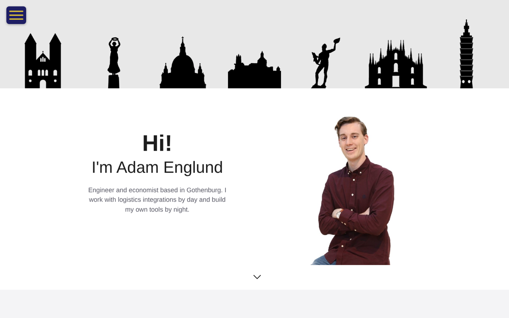
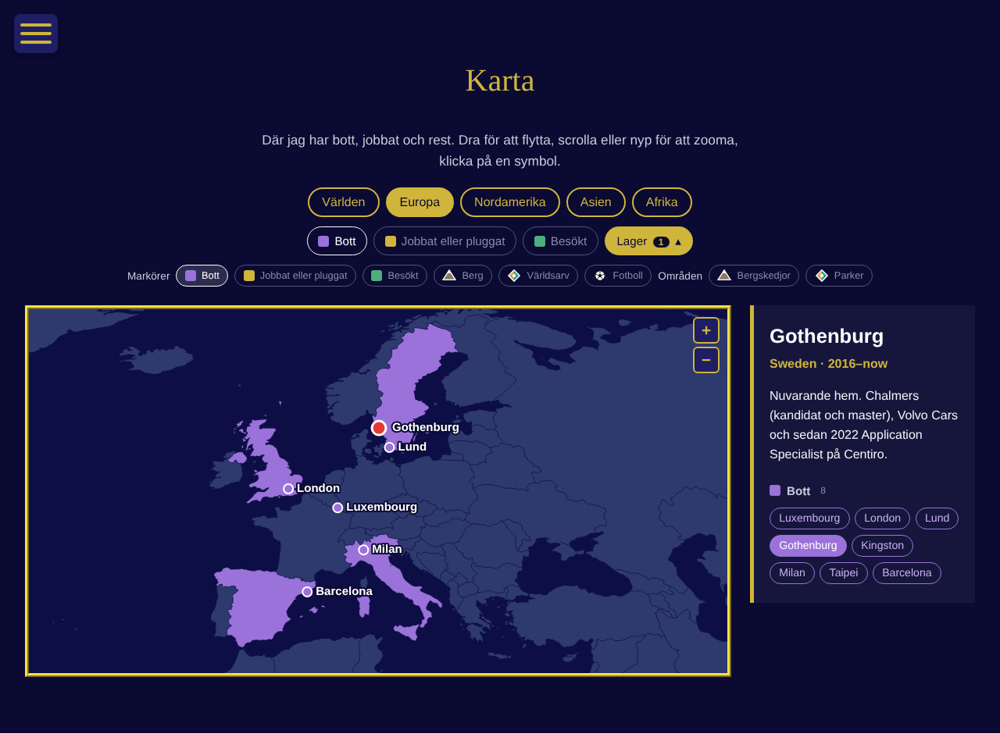

# adamenglund.eu

[](https://github.com/godvig/godvig.github.io/actions/workflows/deploy.yml) [](LICENSE)

My personal website: who I am, what I build and where I've been. It started in 2019 as my first React project and was rebuilt in 2026 as a fast, bilingual, search-friendly page with an interactive travel map.



## Live

**[adamenglund.eu](https://adamenglund.eu)** (English) · **[adamenglund.eu/sv/](https://adamenglund.eu/sv/)** (Swedish)

## Quick start

```
npm install
npm run dev      # http://localhost:5173
npm run build    # static site in dist/, both languages prerendered
npm test         # checks the built pages
```

## Features

- **Two languages, two URLs.** English at `/`, Swedish at `/sv/`, both prerendered with `hreflang` so search engines index each. Visitors whose browser's main language is Swedish land on `/sv/`; the flags in the menu switch and remember the choice.
- **Prerendered.** The build renders the React app to static HTML, so the page shows up instantly and crawlers and link previews see the real content.
- **Interactive map.** Countries, cities, mountains, football away games and 120 UNESCO World Heritage sites, drawn with d3-geo. Filter by layer, zoom, and read a note about each place. The map loads only when you scroll to it.
- **Projects, experience and writing** with links to the live apps, the code, the employers and the published theses.



## Architecture

```
index.html             head tags: title, Open Graph, Person structured data
src/i18n.jsx           language context, detection and the { en, sv } text helper
src/components/        one component per section (Home, Projects, About, Experience, Contact…)
src/components/TravelMap.jsx   the map (d3-geo, d3-zoom, topojson), lazy-loaded via LazyMap.jsx
src/data/places.js     every place on the map, its notes and the Swedish place names
src/counter.js         anonymous visit counting: what is sent, and when nothing is
scripts/prerender.mjs  renders / and /sv/ to static HTML after the build
scripts/check-build.mjs  smoke test of the built pages
```

React 18 + Vite 5. No UI framework, no cookies, no third-party scripts. Visits are counted anonymously with [GoatCounter](https://www.goatcounter.com/): `src/counter.js` sends one request per page load with the path, title, referrer and screen width, and nothing when the browser sends Do Not Track. Hosted on GitHub Pages with a custom domain; every push to `main` builds, tests and deploys.

To edit content: texts live next to the component that shows them, as `{ en, sv }` pairs. Places on the map are in `src/data/places.js`.

## Tests

`npm test` first runs the unit tests for the visit counter (what it sends and when it stays silent), then checks the built site: both languages are prerendered, with the right `lang`, canonical and `hreflang` tags and key content in each. It runs in CI before every deploy, so a broken build never goes live.

## Roadmap

- Self-hosted fonts
- Taller map on mobile

## License

[MIT](LICENSE) for the code. My texts, photos and the employer logos are not covered.
